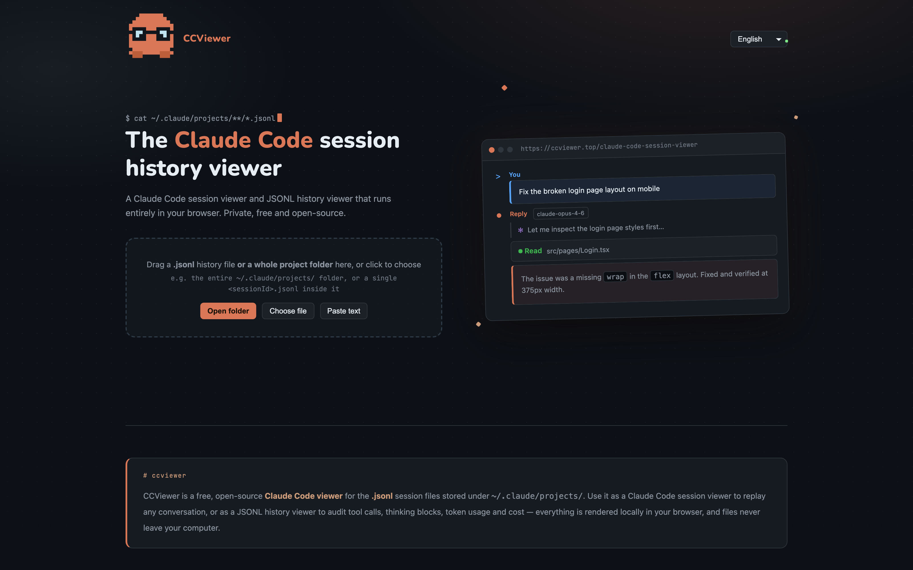
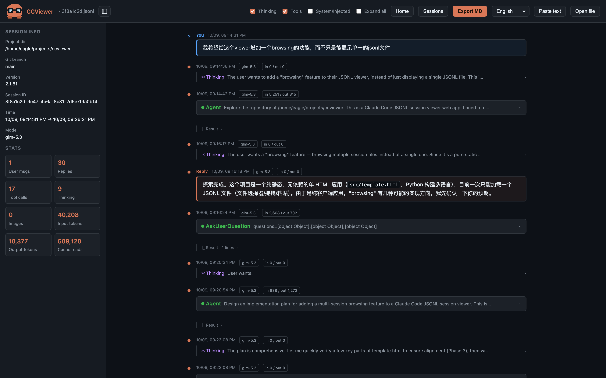
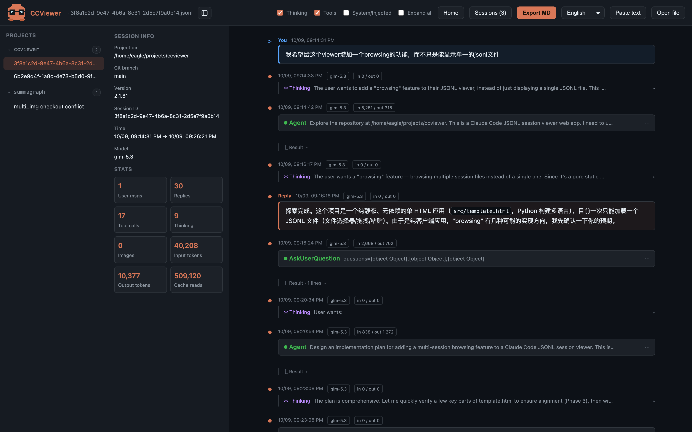

<p align="center">
  
</p>

# CCViewer — Claude Code 会话查看器

**[English](README.md)**

一个免费开源的 [Claude Code](https://claude.com/claude-code) 会话文件查看器。把 `.jsonl` 历史文件（或整个项目文件夹）拖进浏览器，即可回放完整对话——Markdown、思考块、工具调用、Token 用量与费用，全部在本地渲染。

> **客户端查看器。** 会话文件在浏览器中本地解析、渲染和存储。线上网站自动加载 Microsoft Clarity，进行页面统计和录屏；离线版本不加载统计。

**在线体验：** <https://ccviewer.top>（线上与仓库代码完全一致）

## 截图

| 落地页 | 会话查看器 |
|:---:|:---:|
|  |  |

*左：落地页；右：查看器——用户消息、可折叠思考块、工具调用、Markdown 回复，侧栏展示单会话统计（Token、时长、费用）。*

**文件夹模式** — 打开 `~/.claude/projects/` 这样的文件夹，所有会话一次性导入并持久化到浏览器（IndexedDB），左侧按项目聚类：



## 功能

- 📁 **会话库** — 导入整个文件夹（如 `~/.claude/projects/`），会话持久化到 IndexedDB，按项目分组，支持按时间 / 消息数 / Token / 费用排序
- 💬 **完整还原** — Markdown（代码块、表格、列表）、可折叠的思考块、工具调用参数与结果、图片
- 📊 **用量与费用统计** — 输入/输出/缓存 Token、API 时长、代码行数增减、会话总费用
- 🌍 **10 种语言** — English、中文、日本語、한국어、Español、Français、Deutsch、Português、Русский、हिन्दी
- 📤 **导出 Markdown** — 把任意会话导出为可分享的 `.md` 文档
- 🪶 **零依赖** — 单 HTML 文件，无框架；使用无需构建（仅重新生成时需要）

## 使用

### 直接打开

下载 `claude-code-session-viewer/index.html`，浏览器打开即可——支持 `file://` 离线使用。

### 或本地起服务

```bash
python3 -m http.server 8765 -d claude-code-session-viewer
# 打开 http://localhost:8765
```

### 自行部署

纯静态文件，任意静态托管都可以：

- **Cloudflare Pages / Workers** — 仓库已含 `wrangler.jsonc`
- **GitHub Pages** — 指向 `claude-code-session-viewer/` 目录
- **其他** — 上传 `claude-code-session-viewer/` 文件夹即可

## 开发

整个应用在一个源文件里：`claude-code-session-viewer/src/template.html`；界面文案在 `claude-code-session-viewer/src/i18n/*.json`（10 种语言）。

```bash
python3 claude-code-session-viewer/build.py   # 把语言包烘焙成静态页面
```

CI 会在每个 PR 上自动跑构建，构建坏了会先显示红叉 ✗，避免合入。

### 贡献

欢迎提 PR。如新增或修改界面文案，请同步更新**全部 10 个**语言文件（构建时逐键烘焙，缺失的键会直接显示键名）。请保持零依赖，并在浏览器中解析、渲染和存储会话。统计配置由全部生成页面共用。

## 常见问题

**我的会话文件在哪？** Claude Code 把它们存在 `~/.claude/projects/<项目>/<sessionId>.jsonl`（每行一个 JSON 对象）。

**数据如何处理？** 解析、渲染、存储（IndexedDB）在浏览器中完成。线上网站同时向 Microsoft Clarity 发送页面统计和录屏数据。

## 声明

CCViewer 是独立的社区项目，与 Anthropic 无任何隶属或合作关系。"Claude Code" 是 Anthropic 的商标，此处仅为描述性使用。

## 许可证

[MIT](LICENSE)

Clarity 配置与验证步骤见 [统计接入说明](docs/analytics.md)，功能优化、SEO 和外链建议见 [优化建议](docs/growth-plan.zh-CN.md)。

Cloudflare 部署中的帮助页采用无 `.html` 后缀的地址。构建命令也会生成根目录的 `_redirects` 和 `sitemap.xml`，请与 HTML 一起发布。完整路由本地预览：`pnpm dlx wrangler@4.151.1 dev --local --port 8787`；验收命令：`python3 tests/check_routing.py --base http://127.0.0.1:8787`。Python 简单 HTTP 服务可用于查看器本身，但不实现 Cloudflare 的无后缀文章路由。DNS、HTTPS 和 GSC 说明见 [域名与重定向修复](docs/domain-routing.zh-CN.md)。
